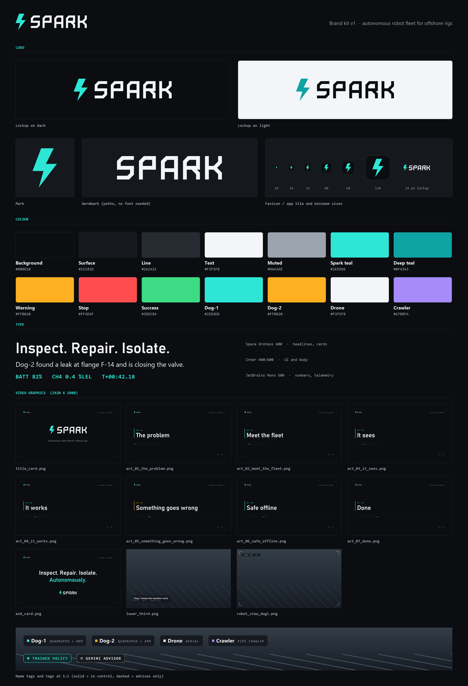

# Spark brand

**Spark** is an autonomous robot fleet for offshore rigs: two quadrupeds with arms, a drone and a pipe crawler, run by an orchestrator, with Gemini as an advisor.

**Positioning:** Spark inspects, repairs and isolates on offshore rigs, so people don't have to go out there.

## Logo

| File | Use |
|---|---|
| `logo/spark-mark.svg` | Glyph only. A spark arc built from seven straight edges. |
| `logo/spark-wordmark.svg` | SPARK lettering, `currentColor`. Monoline strokes on a 72 x 100 grid, one 45° chamfer per letter, and the same diagonal shared by R and K. Pure paths, no font needed. |
| `logo/spark-lockup-horizontal.svg` | Mark plus wordmark. Text is `currentColor`, the mark is spark teal. |
| `logo/spark-lockup-dark.svg` / `.png` | For dark backgrounds: text `#F3F5F8`, mark `#2EE6D6`. |
| `logo/spark-lockup-light.svg` / `.png` | For light backgrounds: text `#0B0D10`, mark `#0FA3A3`. |
| `logo/spark-favicon.svg`, `-16/-32/-180/-512.png` | App tile: the mark on a `#0B0D10` rounded square (radius 7/32). |

- **Clear space:** keep at least the height of one letter stroke times three (about 0.5 x cap height) clear on every side.
- **Minimum size:** lockup 24 px cap height on screen (about 120 px wide). Mark 12 px tall. Below 24 px, use the favicon tile.
- **Don't:** recolour the letters in teal, outline, stretch, rotate, add shadows or glows, put the mark on the right, set "SPARK" in a font instead of the paths, or place the teal mark on a light background (use deep teal there).

## Colour

| Token | Hex | Use |
|---|---|---|
| bg | `#0B0D10` | Page and video background |
| surface | `#15181D` | Panels, captions, tags |
| line | `#262A31` | 1 px hairlines and borders |
| text | `#F3F5F8` | Primary text |
| muted | `#9AA3AE` | Secondary text, labels |
| accent (spark teal) | `#2EE6D6` | The mark, live state, trained-policy tag |
| accent-2 (deep teal) | `#0FA3A3` | Mark on light backgrounds, pressed states |
| warning | `#FFB020` | Anomalies (act 5) |
| stop | `#FF4D4F` | E-stop, recording dot |
| success | `#3DDC84` | Done, valve closed |
| Dog-1 / Dog-2 / Drone / Crawler | `#2EE6D6` / `#FFB020` / `#F3F5F8` / `#A78BFA` | One colour per robot, everywhere |

Teal is the only accent. Use it on one thing per screen.

## Type

All three are on Google Fonts under the OFL. No font files are bundled. `tokens.css` imports them.

| Role | Font | Video (1080p) | UI |
|---|---|---|---|
| Display | Space Grotesk 600, tracking -1% | 112 | 32 |
| H1 | Space Grotesk 600 | 72 | 24 |
| H2 / caption title | Space Grotesk 600 | 44 | 18 |
| Body | Inter 400 / 600 | 32 | 14 |
| Label, telemetry | JetBrains Mono 500 / 600, uppercase, tracking 0.12em | 22 | 11 to 12 |

## Shape

Sharp 1 px hairlines, 10 px radius panels, corner registration ticks on full-frame cards, and no gradients or glows. Solid border = in control (trained policy). Dashed border = advises only (Gemini advisor).

## Voice

Short, confident, plain. Say what the robot did: "Dog-2 closed valve V-3." Use numbers, not adjectives. No hype words (revolutionary, cutting-edge, seamless, game-changing, AI-powered), and no exclamation marks.

## Video graphics (`video/`)

Every graphic has an SVG and a PNG. Full-frame items are 1920 x 1080; tags and name tags are tight transparent PNGs at 1:1 video scale.

- `title_card`, `act_01..07_*`, `end_card`: opaque cards. Act 5 uses warning amber and act 7 uses success green.
- `lower_third`: a transparent 1080p overlay. To make a custom caption, run
  `C:\isaacsim\python.bat brand\build.py caption "Title" "SUB LINE" out.png`
- `robot_view` and `robot_view_{dog1,dog2,drone,crawler}`: viewfinder corners plus the ROBOT VIEW label.
- `nametag_*`, `tag_trained_policy`, `tag_gemini_advisor`.

## Rebuilding

`brand/build.py` defines every graphic once and writes both the SVG and the PNG, plus `tokens.css` and `tokens.json`. No SVG rasteriser was available, so the PNGs are drawn directly with PIL from the same geometry. In the PNGs, Windows fonts stand in for the brand fonts: Bahnschrift for Space Grotesk, Segoe UI for Inter, and Consolas for JetBrains Mono. The SVGs name the real fonts. The wordmark and mark are paths, so they are identical in both.
