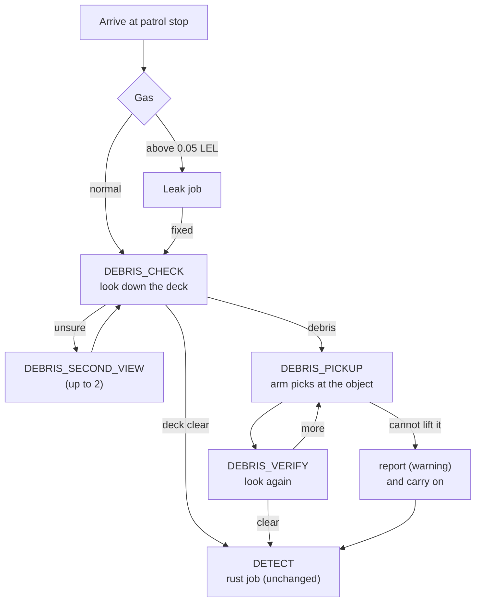
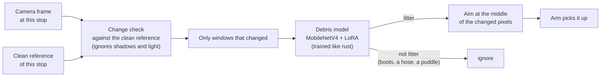
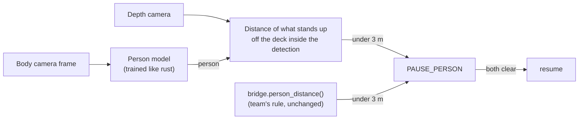

# Deck sweep: picking up debris and seeing people

Two more camera skills on the same robot and the same plan engine as rust repair and the gas-leak job. Both detectors
are trained the same way as the rust and crack models. Numbers and limits:
[`detection/RIG_VISION_RESULTS.md`](../detection/RIG_VISION_RESULTS.md). Bridge methods:
[`integration/INTERFACE.md`](../integration/INTERFACE.md) section 7.

## Where it sits in a patrol stop



Debris is not an emergency: if the robot cannot lift something or cannot tell, it reports it and keeps patrolling.

## How it sees debris



Why the reference: the model alone fired on fire extinguishers and gas bottles it had never seen from that angle
(every empty deck flagged). With the clean reference of each stop, fixed equipment is never a candidate: 73 of 75
objects found and 0 false alarms, under random lighting and shadows.

## How it sees people



The model says *who*, depth says *how far*: 40 of 40 pause decisions right on the held-out deck. The camera can add a
pause; it never removes one.

## Try it

```
python -m policy.leak.mock --leak none --debris litter --person-at 2
python -m detection.eval_rig_vision
```
