# Rust repair robot: diagrams

GitHub renders these Mermaid diagrams. Every number comes from the code on branch `rust-detection`
(`policy/envs/scrub_env_cfg.py`, `detection/models.py`, `detection/RESULTS.md`).

1. [System overview](#1-system-overview)
2. [Repair loop (state machine)](#2-repair-loop-state-machine)
3. [Adaptation: re-planning on an unscripted change](#3-adaptation-re-planning-on-an-unscripted-change)
4. [RL training loop (scrub policy)](#4-rl-training-loop-scrub-policy)
5. [Observation and reward](#5-observation-and-reward)
6. [Rust physics model](#6-rust-physics-model)
7. [CV model architecture](#7-cv-model-architecture)
8. [From pixels to a scrub target](#8-from-pixels-to-a-scrub-target)
9. [Data pipeline](#9-data-pipeline)
10. [Where everything runs](#10-where-everything-runs)

---

## 1. System overview

Perception decides everything the robot does. The detector sees rust, the orchestrator decides what to do, and the
skills act. Each action changes the world, and the camera checks the result.

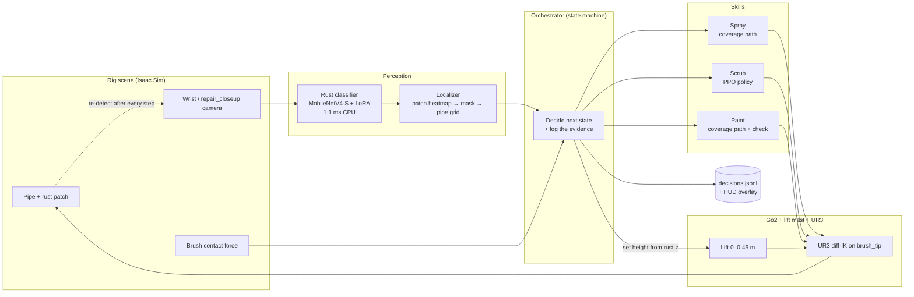

## 2. Repair loop (state machine)

`policy/orchestrator.py`. Every transition writes a `DecisionRecord` with the detector confidence, rust fraction,
patch ids and force behind it.

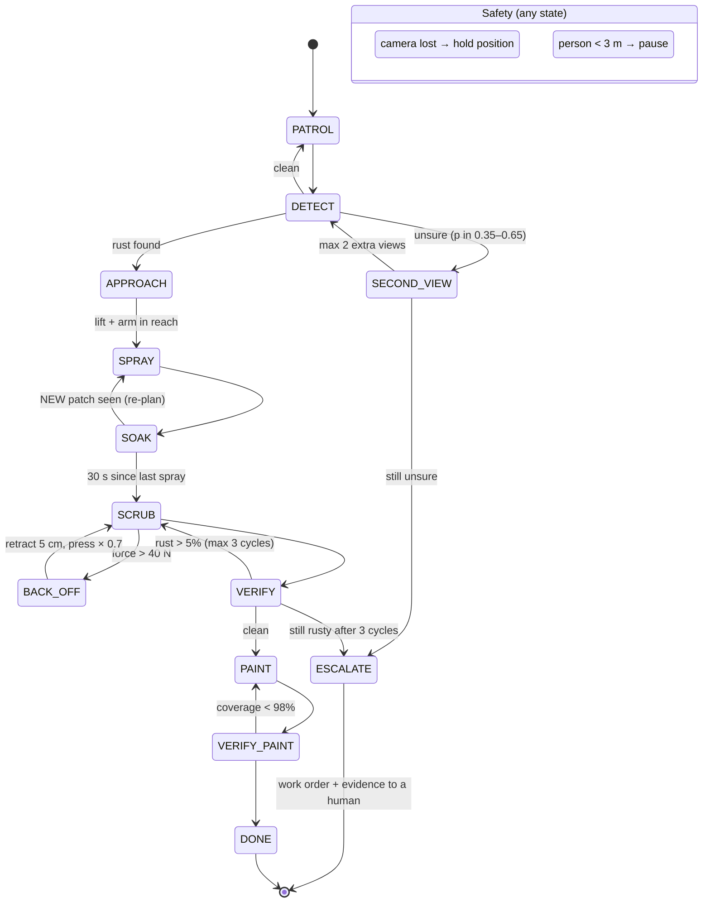

## 3. Adaptation: re-planning on an unscripted change

What the judges see when a new patch appears mid-run. This trace is real output from `python -m policy.demo_mock`.

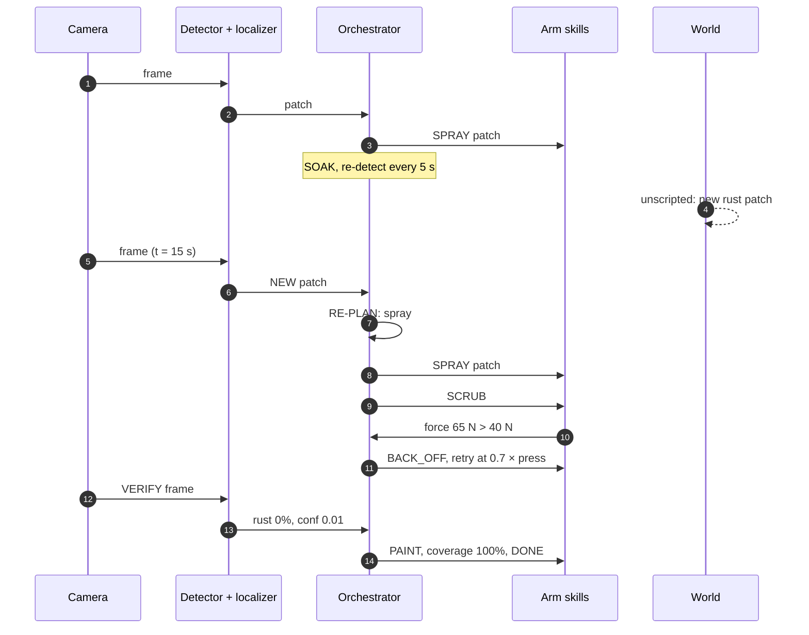

## 4. RL training loop (scrub policy)

`policy/envs/scrub_env.py` and `policy/train_scrub.py`. rsl_rl PPO in Isaac Lab 2.3 on a Modal L40S: 2,048
parallel envs at about 45k env-steps/s. The task is solved by iteration ~20.

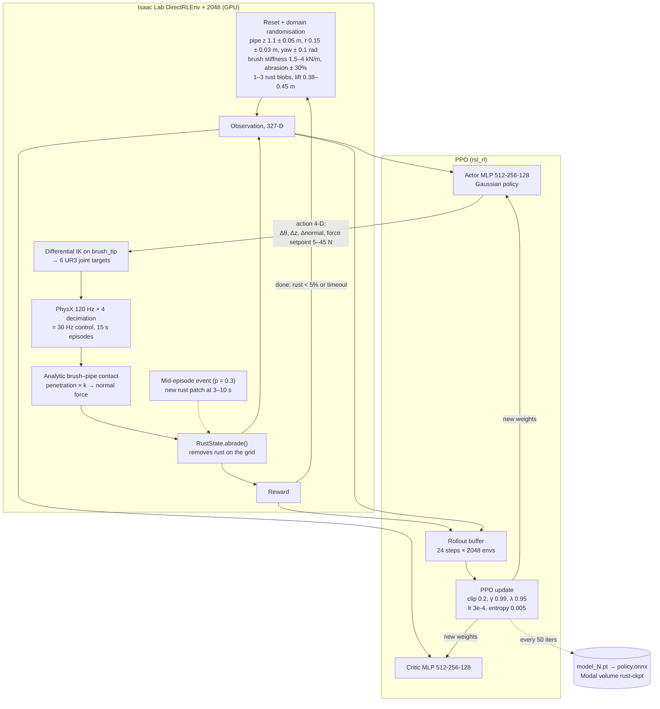

**Learning curve** (`scrub_lift_v1`, `progress.jsonl`)

| Iteration | Mean reward | Rust removed | Success | Episode max force |
|---|---|---|---|---|
| 0 | −0.8 | 0% | 0% | – |
| 10 | 19.5 | 40% | 0% | – |
| 20 | 53 | 96% | 100% | – |
| 100 | 70.5 | 95% | 100% | – |
| 735 | 74.4 | 95% | 100% | 46 N |

Eval on the exact rig geometry, with a new patch injected every episode: **99.2% success, 5.9 s mean time to clean.**

## 5. Observation and reward

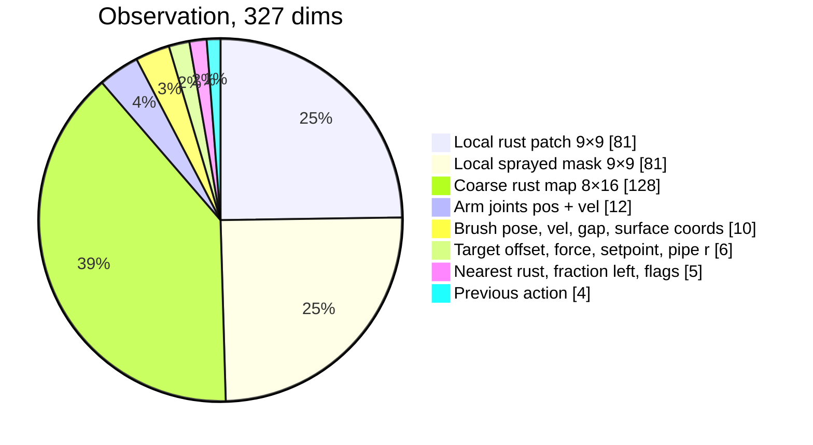

The rust maps are grids on the pipe surface (rows = axial z, columns = angle θ). In deployment the same grid is
filled from the camera by the localizer (section 8), so the policy's input doesn't change.

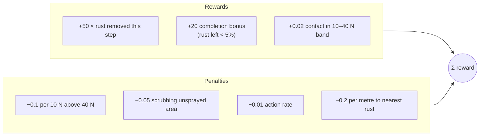

**Known issue:** the over-force penalty is too weak, so mean episode-max force is about 46–52 N. Scrub v2 raises it
5× and clamps the setpoint below 38 N.

## 6. Rust physics model

`policy/envs/rust_state.py`, pure torch, batched over envs. This is why the spray and soak steps matter to the
scrub policy.

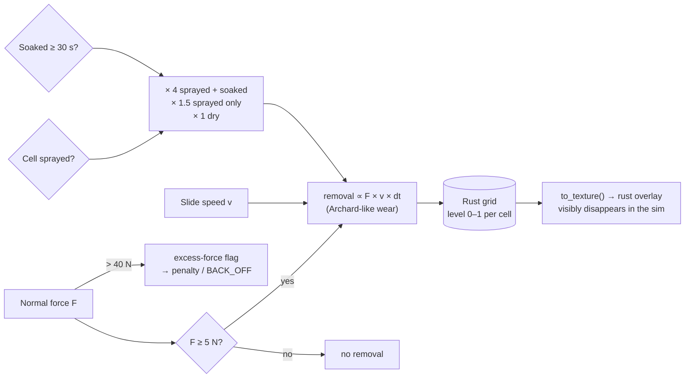

## 7. CV model architecture

`detection/models.py`. MobileNetV4-Conv-Small, ImageNet-pretrained (timm), with **LoRA adapters on its 28 pointwise
(1×1) convolutions**. Only 0.26M of 2.49M parameters train. Shown with real channel counts and strides.

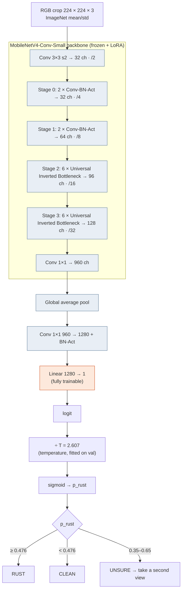

**LoRA inside each 1×1 conv.** The pretrained weight W₀ stays frozen. A low-rank update is learned beside it:

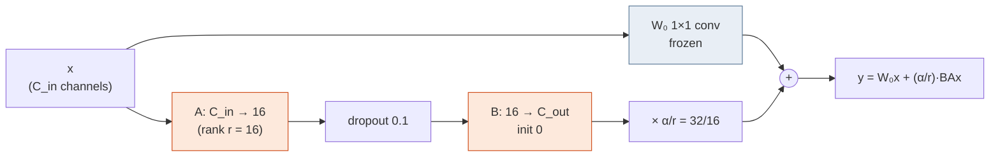

**Training:** BCEWithLogits with `pos_weight = n_clean / n_rust`, AdamW + cosine LR, AMP, RandomResizedCrop + flips
+ mild colour jitter (small hue shift, because rust is defined by colour), early stopping on val PR-AUC. The threshold
is the highest that keeps val recall ≥ 0.95 on both the real and the synthetic subsets, because missing rust is the
costly error.

**Model comparison** (same data, real-photo test set)

| Model | Trainable / total params | Test F1 | AUROC | CPU latency (1 thread) |
|---|---|---|---|---|
| **MobileNetV4-S + LoRA (deployed)** | 0.26M / 2.5M | **0.977** (rust_v2) | 0.998 | **2.6 ms** |
| MobileNetV4-S full fine-tune | 2.5M / 2.5M | 0.972 | 0.995 | 4.3 ms |
| ResNet-18 + LoRA | – / 11.7M | 0.968 | 0.995 | 40.7 ms |
| DINOv2 ViT-S/14 + LoRA | – / 22M | 0.976 | 0.999 | 145 ms |

Sim-domain check (held-out renders of the rig scene): rust_v1 model 10/13 → **rust_v2 model 13/13**.

## 8. From pixels to a scrub target

`detection/localize.py`. The classifier gives a yes/no per crop, so sliding it over the frame produces a map of
where the rust is.

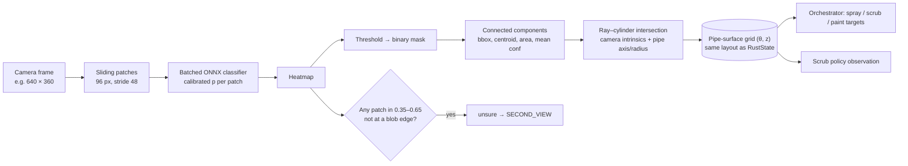

## 9. Data pipeline

`detection/prepare_data.py` and `detection/synth_sim.py`.

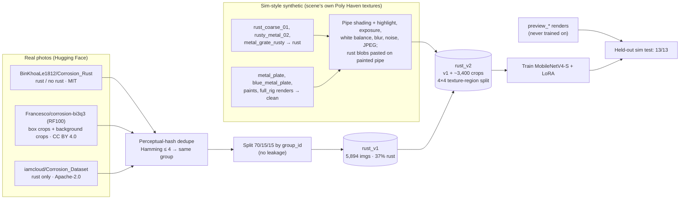

## 10. Where everything runs

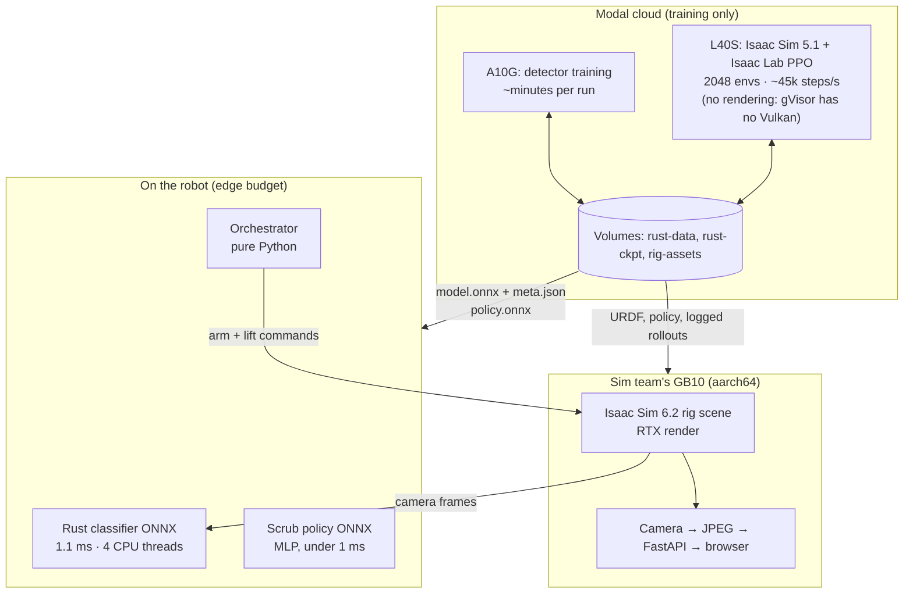

No remote calls are needed at run time. Every decision runs on the device, which is what the autonomy criterion asks for.
