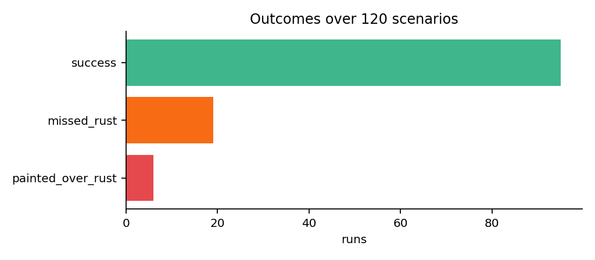
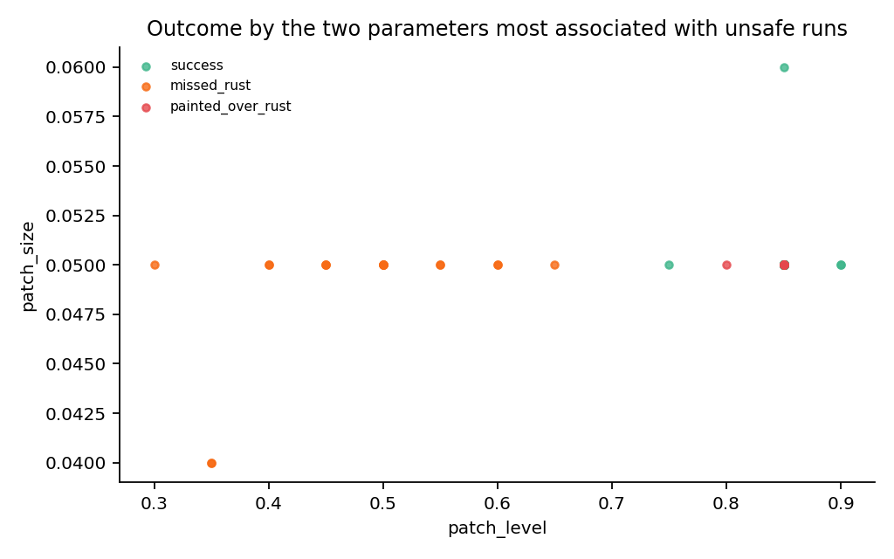
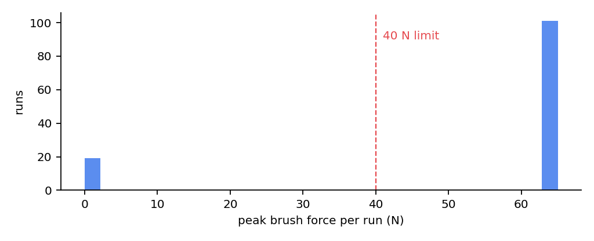

# Gemini test analyst report

**Out of 120 runs, 95 succeeded and safety mechanisms handled all force spikes, occlusions, and human proximity flawlessly, but 25 critical failures occurred due to colour perception missing faint rust under glare and faint residue from stubborn rust.**

- Scenarios: 120 (round n: 60, round rounds: 2, round 1: 60 by gemini, round 2: 60 by gemini, round analysis: gemini)
- Analysis: Gemini gemini-3.1-pro-preview
- Unsafe outcomes: 25 (21%); escalated safely: 0; clean repairs: 95
- New rust injected mid-run was detected in 100% of runs
- 95th percentile peak force: 65.0 N (limit 40 N)
- Wall time: 314 s on CPU

## Failure modes

### 1. Missed Faint Rust on Patrol (critical, 19 runs)

- **Trigger:** Low patch_level (e.g., 0.3 to 0.65) combined with specular glare on the nominal camera view.
- **Likely cause:** The colour classifier yields a low probability (e.g., max p=0.01 < thr 0.50) for faint rust under glare, causing DETECT to confidently predict no rust and skip SECOND_VIEW, ending the patrol prematurely.
- **Suggested fix:** Always trigger SECOND_VIEW (which has no glare) during patrol, or lower the uncertainty threshold to trigger SECOND_VIEW when glare is present.
- **Evidence:** g1-002, g1-020, g1-042, g1-052, g1-053, g1-058, g2-001, g2-002

### 2. Painted Over Stubborn Rust Residue (critical, 6 runs)

- **Trigger:** Low abrasion_coef (e.g., 0.04 to 0.25), representing stubborn rust that leaves faint residue after scrubbing.
- **Likely cause:** The colour-based perception cannot detect the faint residue left by stubborn rust, perceiving 0.0% rust while true rust remains > 5%, causing VERIFY to incorrectly pass and proceed to PAINT.
- **Suggested fix:** Enhance perception for VERIFY (e.g., active lighting, different threshold) or add a minimum scrub cycle requirement based on rust stubbornness.
- **Evidence:** g1-003, g1-015, g1-059, g1-060, g2-008, g2-052

## What worked

- PAUSE_PERSON safety state successfully triggered and resumed for workers within 3 m (e.g., 2.4 m for 2.0 s).
- HOLD safety state correctly paused operations during camera occlusions (e.g., 2 frames) and resumed without false escalations.
- BACK_OFF policy effectively mitigated > 40 N force spikes (e.g., 65 N) by retracting and reducing pressure to x0.7, avoiding the 3 back-offs escalation limit.
- New patch detection worked flawlessly with a 1.0 detection rate during the SOAK phase.

## Next tests

- Test DETECT with forced SECOND_VIEW on all patrol poses to evaluate faint rust detection under glare.
- Test VERIFY with lowered perception thresholds or multi-view inspection to detect faint residue from stubborn rust.
- Test longer camera occlusions (> 5 s) to verify the ESCALATE_TO_HUMAN transition from HOLD.
- Test multiple force spikes (> 3) to verify the BACK_OFF escalation logic.

## Charts

## Parameters most associated with unsafe runs

| parameter | unsafe median | safe median | effect (sd) |
|---|---|---|---|
| patch_level | 0.5 | 0.85 | -2.54 |
| patch_size | 0.05 | 0.05 | 0.0 |
| patch_theta_offset | 0.0 | 0.0 | 0.0 |
| glare_alpha | 0.6 | 0.6 | 0.0 |
| new_patch_delay_s | 12.0 | 12.0 | 0.0 |
| new_patch_theta_offset | 0.75 | 0.75 | 0.0 |
| new_patch_z | 0.13 | 0.13 | 0.0 |
| new_patch_size | 0.04 | 0.04 | 0.0 |

## Method and limits

Each scenario runs the real `policy.orchestrator.Orchestrator` on the CPU mock (`policy/demo_mock.py`): ray-cast camera images, the colour stand-in classifier and the greedy scrub policy. Results describe the orchestrator's decision logic under these stand-ins, not the trained detector or RTX renders; confirm the worst cases in Isaac Sim with `integration/run_repair.py`.

Reproduce: `python -m policy.gemini_analyst --n 60 --rounds 2`. Raw data: `results.jsonl`, `analysis.json`, `gemini_log.json`.

## Checked by hand (not written by Gemini)

The claims above were checked against `results.jsonl`:

- All evidence run ids exist, and every one is a failure with the label Gemini gave it.
- Faint rust: all 17 runs with `patch_level` below 0.65 ended in `missed_rust`.
- Stubborn rust: all 6 `painted_over_rust` runs have `abrasion_coef` below 0.3, and 6 of the 17 runs below 0.3 painted over rust.
- **Glare is not shown to matter.** Glare was on in 119 of 120 runs, so these runs cannot separate glare from faint rust. The report's "under glare" wording is not supported yet. A follow-up with glare off is needed.
- An earlier run, where Gemini saw only parameter names, invented causes ("the arm droops", "the worker blocks the camera"). The prompt now describes what each parameter does, and asks Gemini to say "uncertain" otherwise.
