# Gas-leak job: how it works

The rig robot has two jobs: rust repair (see [diagrams.md](diagrams.md)) and **gas-leak response**, described here.
Both run in the same plan engine, with the same camera, arm, decision log and on-screen overlay. GitHub renders the
Mermaid diagrams. The figures in [`docs/leak/`](leak/) are generated by the real code
(`python docs/leak/make_figures.py`), and every number below comes from the code on branch `gas-leak-isaac`
(`policy/leak/`, `detection/leak.py`, `integration/leak_bridge.py`).

1. [One robot, two jobs](#1-one-robot-two-jobs)
2. [What happens at a patrol stop](#2-what-happens-at-a-patrol-stop)
3. [The leak state machine](#3-the-leak-state-machine)
4. [Safety: what overrides what](#4-safety-what-overrides-what)
5. [Adaptation: a leak starts mid-scrub](#5-adaptation-a-leak-starts-mid-scrub)
6. [Seeing loose bolts](#6-seeing-loose-bolts)
7. [Seeing cracks, without ML](#7-seeing-cracks-without-ml)
8. [Deciding what is wrong](#8-deciding-what-is-wrong)
9. [The gas model](#9-the-gas-model)
10. [In Isaac Sim](#10-in-isaac-sim)
11. [What the video shows](#11-what-the-video-shows)
12. [Evidence and limits](#12-evidence-and-limits)
13. [Where the code is](#13-where-the-code-is)

---

## 1. One robot, two jobs

A gas sensor tells the robot *that* something is leaking. The wrist camera tells it *what*: a loose bolt it may fix,
or a crack it must never touch. Everything it decides is logged with the evidence behind it.

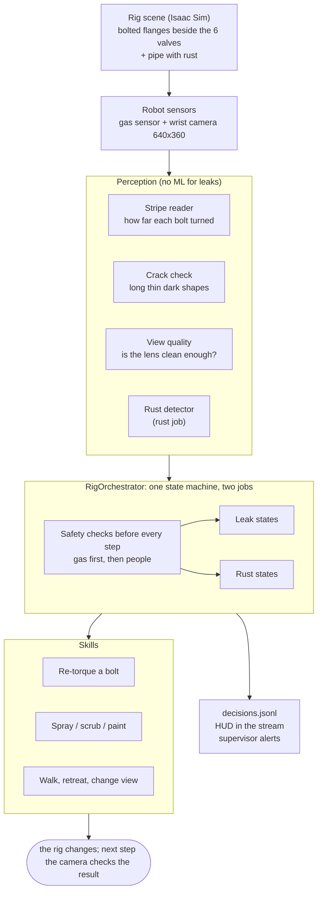

## 2. What happens at a patrol stop

The gas check comes first at every stop. Rust work only starts once the air is normal.

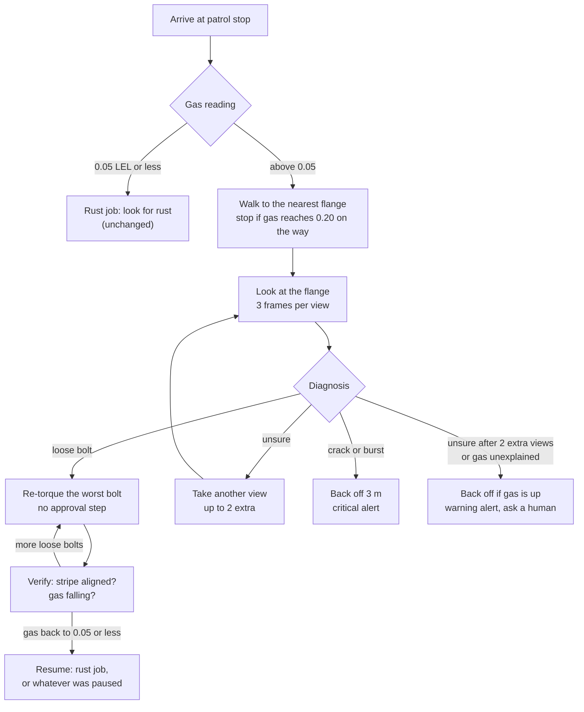

## 3. The leak state machine

These states were added to the team's `Orchestrator` (`policy/orchestrator.py`) by `RigOrchestrator`
(`policy/leak/job.py`). With no leak job attached it is the plain rust robot. "Any state" means the gas check
that runs before every step (section 4); `DETECT` is where the rust job takes over, or the paused rust state resumes.

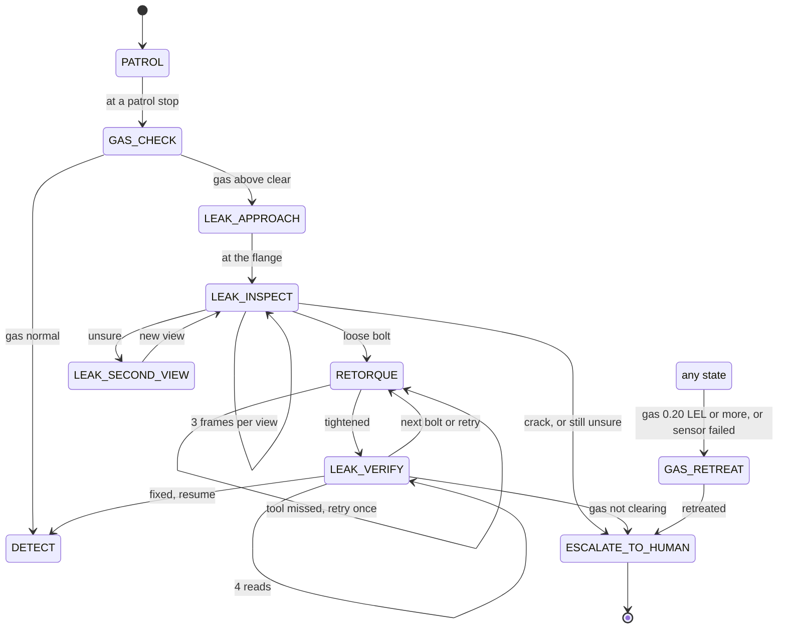

## 4. Safety: what overrides what

Before every step, and every step of a scrub, the checks run in this order. Gas comes first because it is the most
severe hazard.

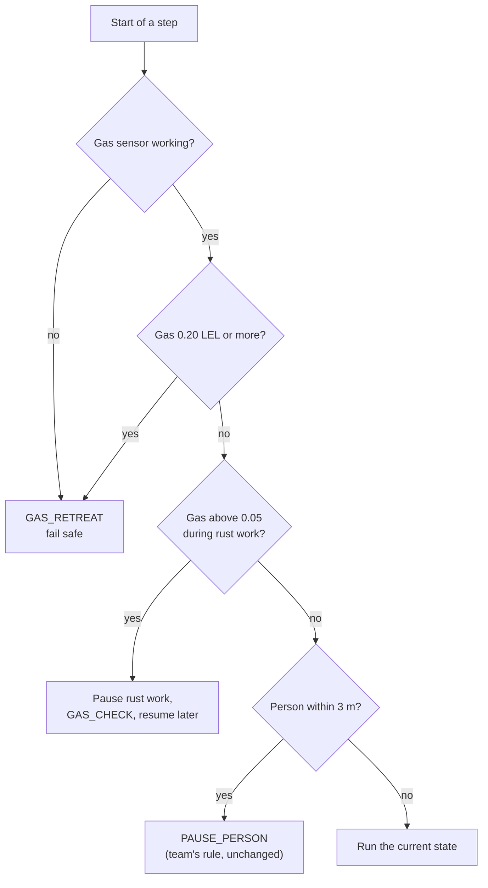

**Before any tightening:** the diagnosis must be a confident loose bolt, the bolt's stripe must have been read with
confidence 0.7 or more, gas must be below 0.20 at the start of the step, and the bolt must be in reach. There is no
human approval step (team decision). The supervisor is alerted after every repair, and immediately for anything the
robot will not handle.

## 5. Adaptation: a leak starts mid-scrub

The scene changes without telling the robot. It notices through the gas sensor, fixes the leak with the camera and
arm, and goes back to the rust exactly where it left off.

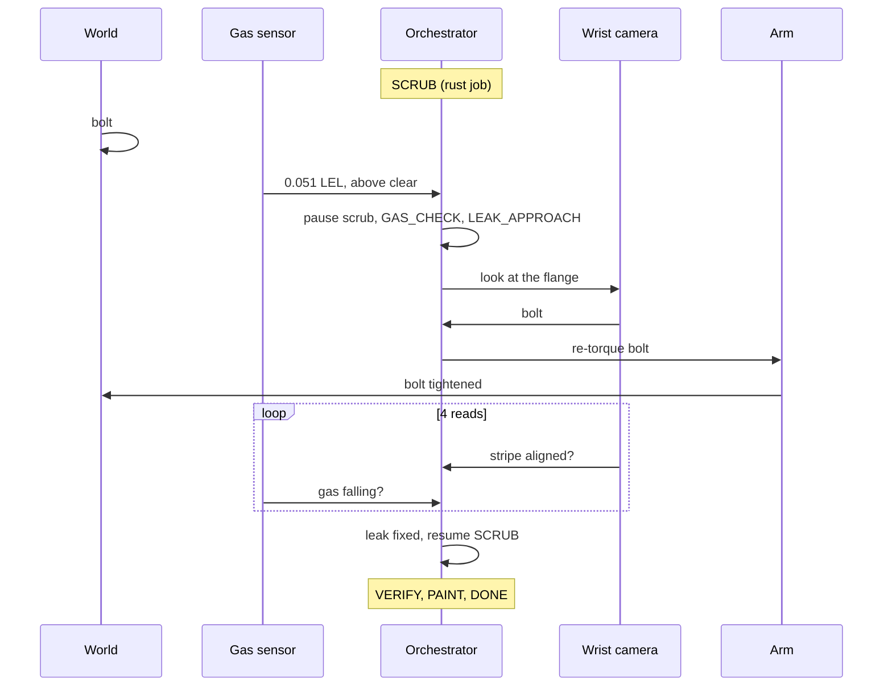

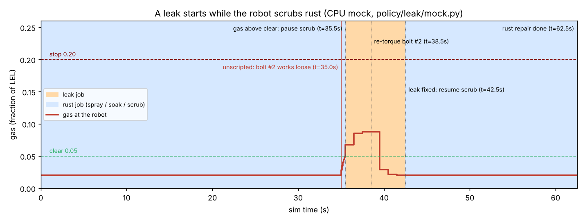

## 6. Seeing loose bolts

Every bolt has a red stripe painted across its head and on across the flange face. When the bolt turns, the head
part rotates and the face part does not. The camera measures the angle between where the stripe *should* point and
where it *does* point. No ML.

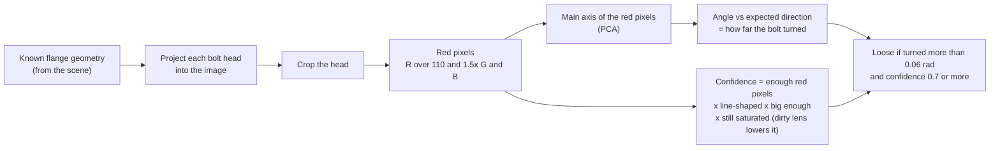

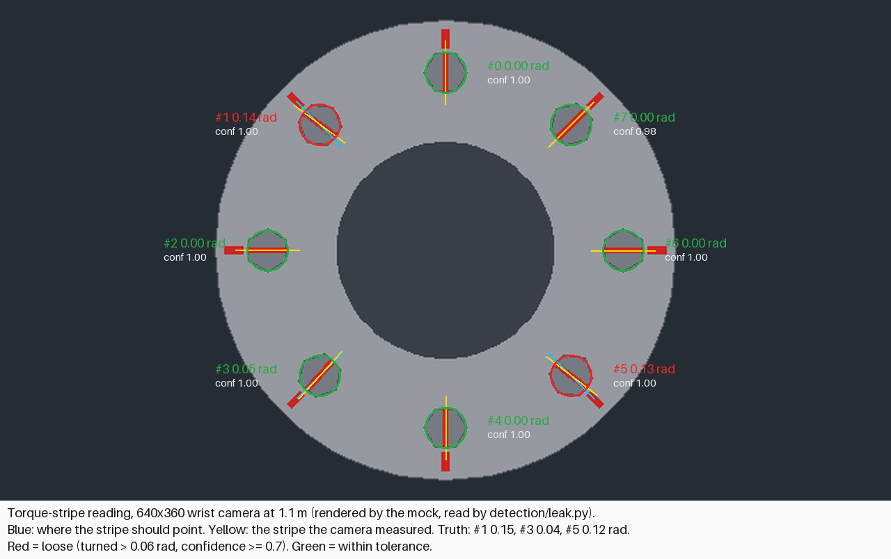

Measured on the mock's renders through the 640x360 wrist camera at 1.1 m: every bolt read, angle error at most
0.019 rad (about 1 degree), confidence 0.95 or more on a clean lens. Confidence falls below 0.7 at about 0.2 dust.

## 7. Seeing cracks, without ML

Same flow as the rust detector (evidence, then a probability, a threshold, an unsure band, another view), but the
evidence comes from a classical check instead of a trained model.

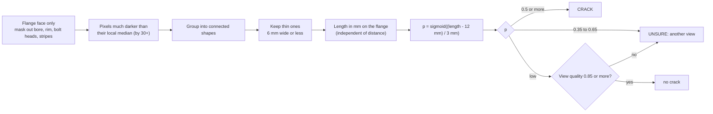

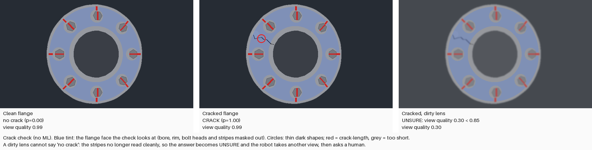

**The view-quality rule** is what keeps it safe. A dirty or hazy lens hides cracks before it hides the stripes, so if
the stripes do not read cleanly (mean confidence below 0.85), "no crack" is not trusted and becomes "unsure".

Held-out renders at the Isaac camera setup (`python -m detection.eval_leak_sim`): **40 of 40 cracks found, no false
alarms**. Across crack severity 0.05 to 0.3, dust 0 to 0.45 and glare: no silent misses (every crack flagged or
reported unsure) and no false alarms. The earlier sliding-window check found 9 of 40.

**Optional ML path**, only if the classical check fails on real Isaac frames: `LeakLocalizer.from_checkpoint(dir)`
loads a model in the rust detector's `model.onnx` + `meta.json` layout, trained by `detection/train_leak.py` with the
team's trainer unchanged. One epoch reached validation F1 0.98, so the path works, but it is not used by default.

## 8. Deciding what is wrong

`policy/leak/diagnose.py`. Readings from all frames and views are combined (weighted by confidence squared), then
checked in this order. The more severe or more uncertain answer always wins.

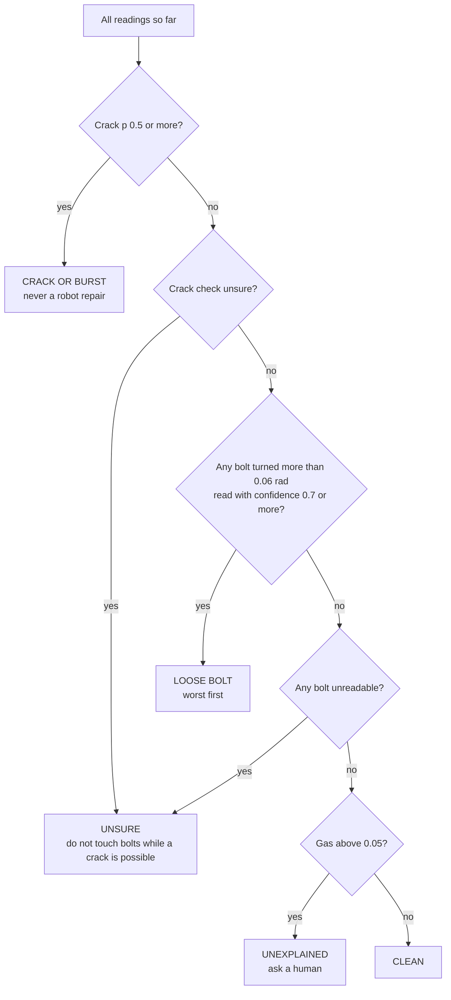

After the confident repairs, if gas is still above 0.05, the robot tightens up to 2 more "suspect" bolts (turned more
than 0.03 rad) once, then asks a human if the gas still does not clear.

## 9. The gas model

`policy/leak/world.py`. **Illustrative numbers**, chosen so that small leaks can be approached and fixed while big
ones trip the stop limit before the robot gets close.

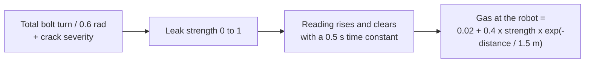

| Situation | Patrol stop (1.47 m) | Isaac viewing pose (1.1 m) | Mock viewing pose (0.85 m) |
|---|---|---|---|
| Two bolts turned 0.15 and 0.12 rad | 0.088 (above 0.05: check it) | 0.106 (below 0.20: safe to work) | 0.122 |
| Burst (strength 1.0) | 0.170 | 0.212 (0.20 or more: stop and retreat) | 0.247 |

Computed by `LeakWorld.gas_at` at steady state.

## 10. In Isaac Sim

`python sim/build_leak_flanges.py` adds a bolted flange beside each of the rig's 6 valves as a separate layer, so
`full_rig.usda` is untouched. **Open `sim/output/full_rig_leak.usda`.** Placement is a guess from the valve positions
and must be checked by eye.

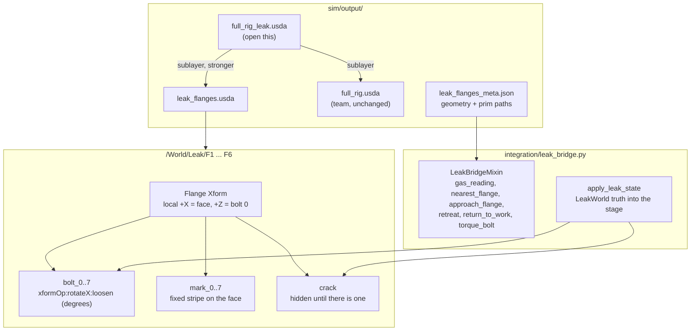

The USD bolt positions and stripe directions match the geometry the camera code uses to within 0.05 mm (tested), so
when Isaac renders the flange, the stripe reader looks exactly where the bolts are.

**What exists and what does not:**

| Piece | State |
|---|---|
| Leak states in the plan engine | built, tested against the mock |
| Bolted flanges in the rig scene | built (USD), not yet looked at in Isaac |
| Bridge methods for the leak job | built, tested with a fake robot |
| **The team's Isaac bridge class** (SimBridge + Perception + ArmController) | **does not exist yet, for either job** |
| Running inside Isaac Sim | **not done** |

## 11. What the video shows

The same 4-line HUD as the rust job, burned into the stream. In leak states it shows gas, the diagnosis, and the bolt
and crack readings. Retreats and escalations appear in the alert colour.

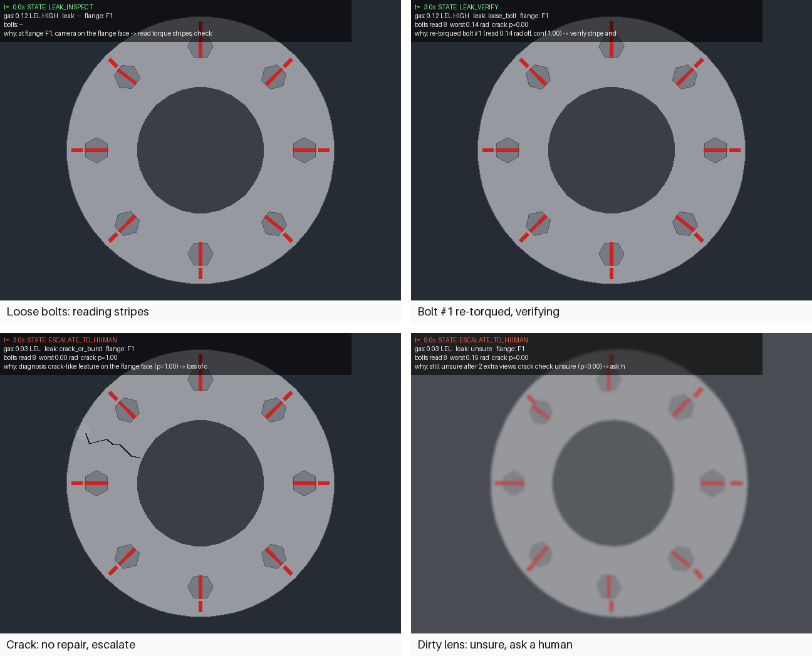

| Hook (call on `LeakWorld`, then `apply_leak_state`) | What you see |
|---|---|
| `loosen(flange, bolt, rad)` while scrubbing | `SCRUB -> GAS_CHECK`, bolt fixed, `LEAK_VERIFY -> SCRUB` |
| `crack(flange, severity)` | `LEAK_INSPECT -> ESCALATE_TO_HUMAN`, critical alert, no tightening |
| `gas_spike(flange)` | `GAS_RETREAT -> ESCALATE_TO_HUMAN`, critical alert |
| dirty lens | two extra views, then `ESCALATE_TO_HUMAN` (unsure) |

Try it on CPU: `python -m policy.leak.mock --leak loose` (also `crack`, `big`, `none`, `dust`, `--gas-during-scrub`).

## 12. Evidence and limits

**Tested:** 104 tests pass on the branch, including the team's 66 unchanged. They cover each scenario end to end in
the mock, a safety sweep (never tighten in gas at the limit, never tighten a cracked flange, never finish "done" with a
loose bolt, with clean-lens loose-bolt cases required to actually tighten), the stripe reader's accuracy, the crack
check's "no silent miss" property, and the USD scene's agreement with the perception geometry.

**Limits, stated plainly:**
- Nothing has run inside Isaac Sim. The team's Isaac bridge does not exist yet.
- The image checks were tuned on the mock's simple renders. Isaac adds lighting, shadows and materials; re-test on
  real stream frames before the demo.
- The gas model and all thresholds are illustrative, not from a site standard.
- Tightening sets the bolt straight in the simulation; thread friction and torque are not simulated.
- A dirty lens makes the robot ask a human even when the flange is fine. That is a deliberate trade-off.

## 13. Where the code is

| File | What |
|---|---|
| `policy/leak/job.py` | `RigOrchestrator`: leak states, gas pre-emption, alerts, HUD |
| `policy/leak/diagnose.py` | diagnosis rules and evidence accumulation |
| `policy/leak/world.py` | `LeakWorld`: bolts, cracks, gas |
| `policy/leak/geometry.py` | flange geometry shared by scene, renderer and perception |
| `policy/leak/render.py`, `policy/leak/mock.py` | CPU mock: flange renderer, bridge, arm, demo |
| `detection/leak.py` | stripe reader, classical crack check, optional ONNX path |
| `detection/eval_leak_sim.py` | held-out crack check on renders |
| `sim/build_leak_flanges.py` | bolted flanges in the rig (USD) |
| `integration/leak_bridge.py` | leak half of the Isaac bridge |
| `integration/INTERFACE.md` section 6 | the contract for the sim team |
| `docs/leak/make_figures.py` | regenerates the figures on this page |
